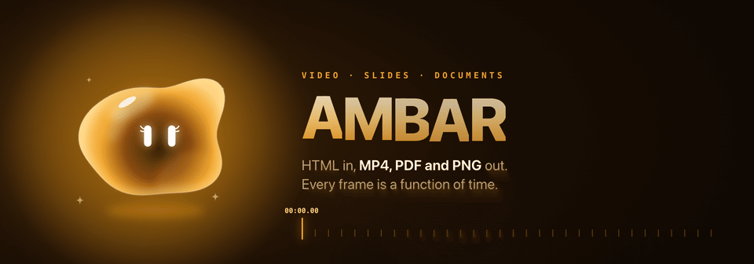
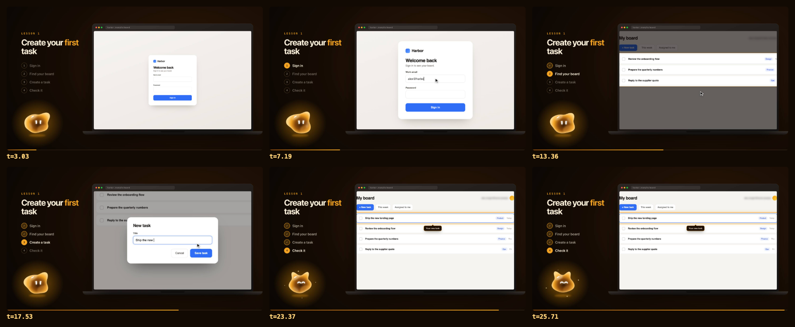
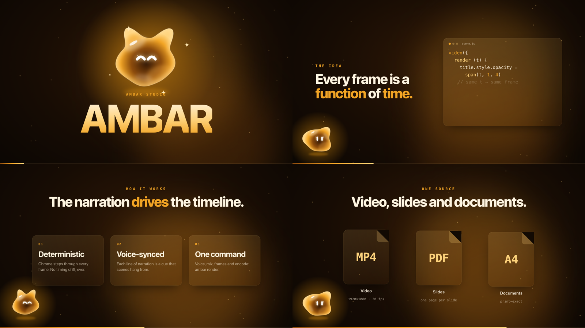
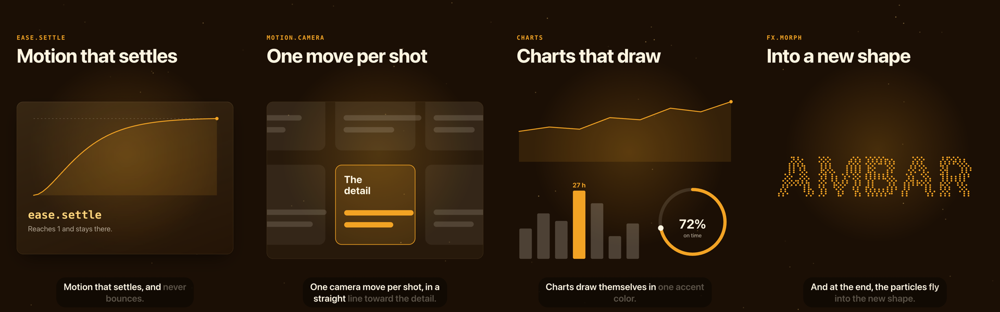
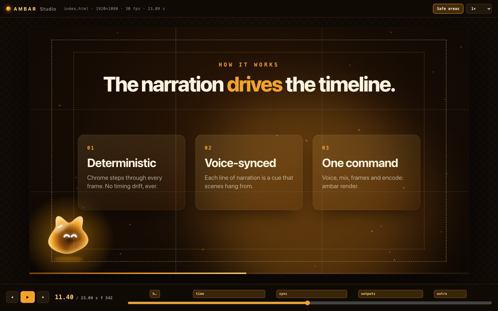
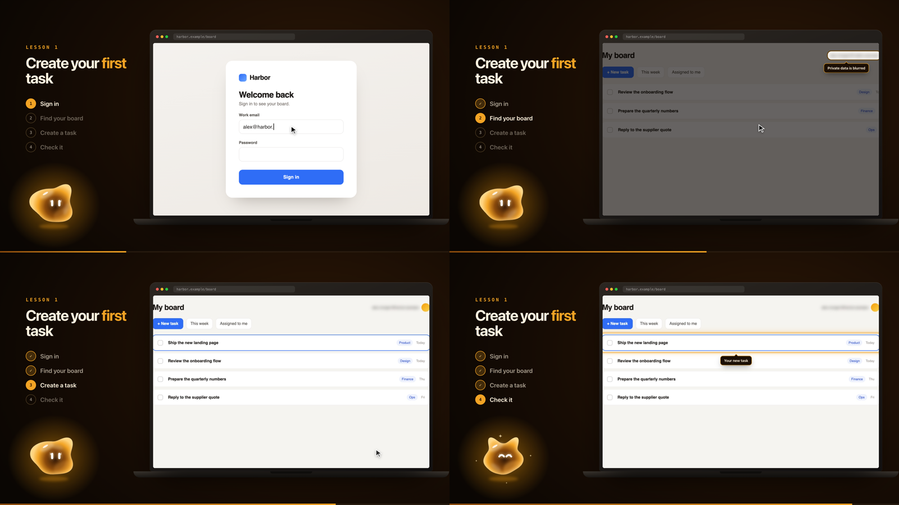
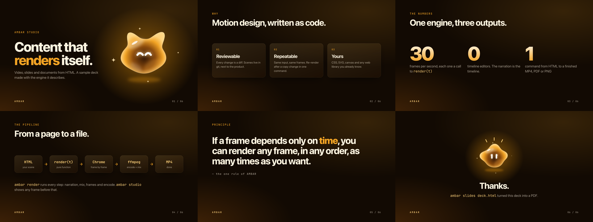
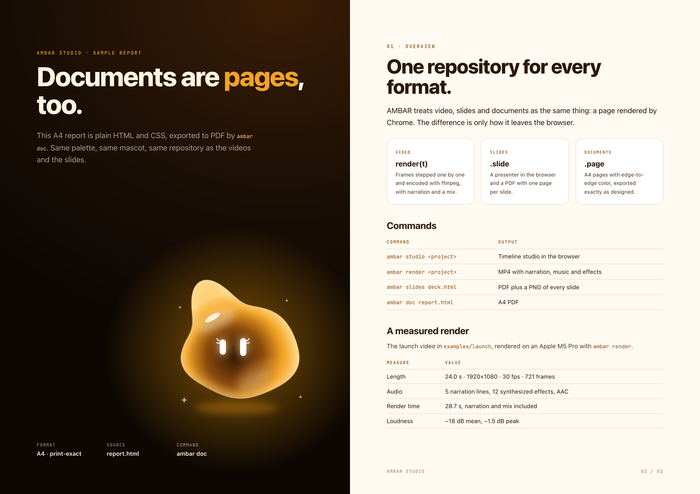
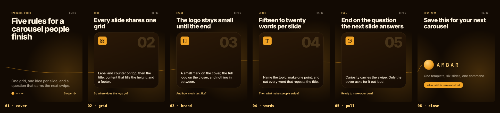
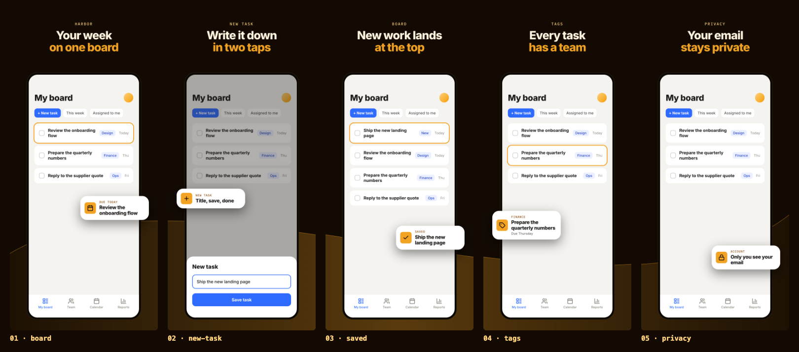

<p align="center">
  
</p>

<p align="center">
  <b>Video</b> &nbsp;·&nbsp; <b>Slides</b> &nbsp;·&nbsp; <b>Documents</b> &nbsp;·&nbsp; from HTML
  <br><br>
  <a href="README.es.md">Leer en español</a>
</p>

AMBAR Studio turns web pages into finished media. You write a scene in HTML, CSS and JavaScript; AMBAR renders it frame by frame in headless Chrome and encodes it with ffmpeg, with narration, music and sound effects mixed in. The same pages become slide decks and print-ready documents.

It rests on one rule: **every frame is a function of time.** A scene exposes `render(t)` and depends on nothing else, so any moment can be rendered exactly the same, in any order, as many times as you want. That's what makes the output repeatable, reviewable in git, and easy to change after a copy edit.

Everything in this README was rendered by AMBAR itself.

### `// 01` What you get

| | |
|---|---|
| **Deterministic video** | `render(t)` stepped by Chrome and piped to ffmpeg. 1080p at 30 fps by default, any size or frame rate you set. |
| **Narration that drives the timeline** | Each line of narration is a cue. Scenes hang from cues, so editing a line moves its scene with it. |
| **Characters and voices** | Several characters, each with its own voice, recorded in one take per character and cut at the pauses. Pronunciation fixes stay out of the subtitles, and `--verify` transcribes every line against the script. |
| **A real mix** | Music that ducks under the voice with an envelope follower and lands its hit on the moment you choose, sound effects synthesized or aligned on their peak, −14 LUFS. |
| **Motion that settles** | Cameras, transitions, word-timed captions, particles, self-drawing charts and beat grids, all functions of time. No bounce, no overshoot. |
| **A studio** | A timeline in the browser with cue markers, frame stepping, safe areas and the mix in sync. |
| **Slides and documents** | Decks with a browser presenter and a PDF per deck; A4, Letter and A5 documents, and long pages for infographics. Every PDF is checked for Type 3 fonts, shadows and page count. |
| **Still images** | Carousels, store screenshots, link cards, stories and covers in every size from one template and a data file. |
| **Product tutorials** | Captures of a real app with private data blurred, then camera, cursor, typing and callouts pointed at elements by name. |
| **Made for Claude** | A Claude Code skill, an agent and a self-review command, so an AI can make a piece end to end and check it. |
| **ÁMBAR** | The mascot, drawn as SVG on every frame: expressions, blinks, gaze, and talking with the real voice. |
| **Learned from real work** | The house rules come from about seventy finished pieces: what worked, what was rejected and why. |

### `// 02` Made for Claude

AMBAR is built to be driven by an AI agent. The repo ships a Claude Code skill and an agent that know the workflow and the house rules, and a check command that lets the agent review its own work before it says it is done.

```bash
ambar skill    # links the skill and the agent into ~/.claude
```

Then ask Claude Code for what you need, from any folder: *"a 30-second launch video for this feature"*, *"a tutorial of the sign-up flow on staging"*, *"a 10-slide deck from this report"*.

| Piece | What it does |
|---|---|
| **`ambar` skill** | The workflow (brief → one test piece → plan → build → voice → check → render) and the rules learned from finished pieces: timing from narration, motion without bounce, safe areas and minimum sizes, plain writing without hype, nothing invented, private data blurred, never capturing production. One reference per format, plus `craft.md` with the reason behind each rule. |
| **`AMBAR.md` brief** | Each project's own rules: audience, goal, language, voice, tone, brand, words to use and avoid, sources, what to blur. `ambar new` creates it; the skill reads it before anything else and follows it over the defaults. |
| **`ambar check`** | The machine review: page errors and missing files, text off the frame, clipped or overlapping, labels inside diagrams crossed by a line or covered by a shape, text too small to read, content too small or bunched at one edge, cues without narration, and whether `render(t)` depends on `t` alone. Writes a contact sheet the agent then looks at. `--json` for agents. |
| **`ambar-producer` agent** | Produces a whole piece from a brief, end to end. One per piece to make several in parallel. |

<p align="center">
  
</p>

### Music and open resources

`music/` ships three CC BY 4.0 tracks by Kevin MacLeod that any project can use (`"music": { "file": "@ambar/music/inspired.mp3" }`); credits in `music/README.md`. For anything else (music, sound, voices, fonts, icons, photos and libraries that work with `render(t)`) the skill keeps a license-checked guide in `.claude/skills/ambar/references/resources.md`.

### `// 03` Quick start

Requires Node 20+ and `ffmpeg` (`brew install ffmpeg` on macOS).

```bash
npm install -g ambar-studio   # the `ambar` command
ambar new my-video            # start a project
```

To try the bundled examples, clone the repo:

```bash
git clone https://github.com/4mser/ambar-studio.git
cd ambar-studio
npm install
npm link                      # makes the `ambar` command available

ambar studio examples/launch  # open the launch video in the studio
ambar render examples/launch  # → examples/launch/out/launch.mp4
```

Start your own:

```bash
ambar new my-video            # or: ambar new my-deck --deck · ambar new my-doc --doc
ambar studio my-video
```

### `// 04` A scene

A composition is a folder with an `index.html`. This is the whole contract:

```html
<link rel="stylesheet" href="/@ambar/runtime/ambar.css">
<div id="stage"><h1 id="title"></h1></div>

<script type="module">
  import { video, cue, words, rise } from '/@ambar/runtime/ambar.js'

  let title

  video({
    setup () {
      title = words(document.getElementById('title'), 'Hello, {world}.')
    },
    render (t) {
      rise(title, t, cue('hello', 0.8).start)   // words rise in when the narration says "hello"
    }
  })
</script>
```

The runtime ships the pieces that make motion feel right: easings (`out`, `inOut`, `outBack`, `spring`, …), `span` for things that ease in, hold and ease out, `keys` for keyframes, `rise` and `fadeUp` for text, `type` for typing, `count` for numbers and `hash` for deterministic particles.

<p align="center">
  
</p>

### `// 05` Narration and sound

`ambar.json` sits next to the scene. Lines become cues, and effects can be placed in seconds or relative to a cue:

```json
{
  "voice": { "provider": "gemini", "name": "Sulafat", "language": "es-US", "mode": "take" },
  "voices": { "ambar": { "name": "Leda", "style": "A cheerful little mascot" } },
  "lines": [
    { "id": "hello", "text": "Te presento a NGINX.", "say": "Te presento a Engine X." },
    { "id": "hola",  "speaker": "ambar", "text": "¡Hola! Yo te acompaño.", "pause": 0.6 }
  ],
  "music": { "file": "music.mp3", "gain": 0.6, "hit": 15.25, "at": "hola" },
  "sfx": [
    { "type": "whoosh", "at": "hello-0.3", "gain": 0.14 },
    { "file": "sfx/stamp.wav", "at": "hola+0.8" }
  ]
}
```

| Voice provider | Notes |
|---|---|
| `say` | macOS voices, offline, no key. Good for drafts. |
| `gemini` | Gemini text-to-speech, with model fallback and retries. Reads `AMBAR_GEMINI_API_KEY`, or on macOS the Keychain item `ambar-gemini`, and nothing else. |

- **Characters.** `speaker` picks a voice from `voices`. With `"mode": "take"` each character reads all of its lines in one take, which AMBAR cuts at the longest pauses: lines recorded one by one sound like different people. `ambar voice --recut` cuts again without recording.
- **Pronunciation.** `say` is what the voice reads, `text` what the screen shows, `caption` what the captions show. `tone` sets how one line is said.
- **Pace.** Long pauses inside a line are shortened to `maxPause` (0.32 s), `tempo` speeds a slow take up to 1.15×, and every line gets short fades so none stops dead.
- **For the scene.** `voice/timings.json` has every cue with its text, speaker and word timings; `voice/envelope.json` says how loud each line is, frame by frame, so a mascot talks with the real voice.
- **Verify.** `ambar voice --verify` transcribes every line literally and lists missing or extra words and lines that are too slow.
- **Music.** It ducks under the voice with an envelope follower. `hit` + `at` line a moment of the track up with a cue; `stop` cuts it dead or stops it like tape.
- **Effects.** `whoosh`, `tap`, `tick`, `click`, `pop`, `impact`, `kick`, `riser`, `heartbeat`, `drone`, `applause` and `glitch`, synthesized with a fixed seed (no bells: they read as cheap). A `file` effect lands on its loudest point.
- **Master.** Soft-clipped and normalized to −14 LUFS (`loudness`). `ambar render --cover 3.2` also writes `<name>-cover.mp4` with that frame first, because feeds use frame 0 as the thumbnail.

### `// 06` Motion

The motion language from finished pieces, as plain functions of time.

| Module | What's in it |
|---|---|
| `ambar.js` | Easing (`ease.settle`, a critically damped curve that never overshoots), `seeded`, `noise1`, `remap`, `revealLines`, `scramble`, `counter`, and named formats: `video({ format: 'post' })` for 4:5, `reel`, `story`, `square`, `card`, with `ctx.safe` telling you where titles, content and captions go |
| `motion.js` | A `camera` that frames any element and moves in one straight line without showing the frame's edge, `breathe`, `punch` without ringing, `handheld`, `beats` and `acts` for cutting to music, `smoothPath`, `reversals` for QA, and `sim()`, which replays a stateful simulation exactly at any frame |
| `fx.js` | Stateless particles (dust, bursts, confetti, trails, `morph` into a new shape) and the few transitions the house style allows: crossfades, light sweeps on cuts, a circle reveal, an appear from blur |
| `charts.js` | Flat line, bar, ring, sparkline and heat charts that draw themselves, built once and updated by attributes |
| `captions.js` | Word timings into two-line captions that light up word by word, with the speaker's name and figurine; `talk()` reads the voice envelope |

<p align="center">
  
</p>

### `// 07` The studio

`ambar studio <project>` opens the composition in a local studio: scrub the timeline, step frame by frame, jump to any narration cue, toggle safe areas and play the mix in sync.

<p align="center">
  
</p>

### `// 08` Tutorials over real apps

`ambar capture` walks through a web app with headless Chrome, following the steps in `capture.json`, and saves a screenshot per step plus the position of every element you name. Anything matching `redact` is blurred in the browser before the screenshot, so private data never reaches a PNG.

```json
{
  "url": "app/index.html",
  "redact": ["[data-private]"],
  "shots": [
    { "name": "login", "boxes": { "email": "#email", "signin": "#signin" } },
    { "name": "board", "actions": [{ "type": "#email", "text": "alex@harbor.example" }, { "click": "#signin" }, { "waitFor": "#list" }],
      "boxes": { "list": "#list", "user": "[data-private]" } }
  ]
}
```

`runtime/screen.js` turns those captures into a screencast inside a laptop, browser or phone frame. Camera, cursor, typing, spotlights and callouts are functions of time like everything else, and they point at elements by name (`'login.email'`), not by pixel.

```js
const sc = screencast(stage, await loadShots(), { device: 'laptop' })
sc.show(t, [[0, 'login'], [signin.start + 4.6, 'board']])
sc.camera(t, [[signin.start, 1, [720, 450]], [signin.start + 0.6, 1.55, 'login.card']])
sc.cursor(t, [[signin.start + 0.85, 'login.email'], [signin.start + 4.35, 'login.signin']], clicks)
sc.type(t, { box: 'login.email', text: 'alex@harbor.example', at: signin.start + 1.1 })
sc.callout(t, { box: 'board.user', text: 'Private data is blurred', from: board.start + 3.2 })
```

`ambar capture` can also record an app in motion. Add `recordings` to `capture.json` and each clip is filmed frame by frame on a virtual clock: the app's timers, animation frames, dates and CSS animations only move one frame at a time, so slow machines film smooth clips and two runs give the same frames. Taps, typing, scrolls, drags and marks are scripted to the frame, and every tap is logged so the scene can draw the finger where and when it touched. Pages get a fixed date and time zone, seeded storage and phone safe areas. Writes never leave the browser: they are blocked or mocked, and slow responses can be held back to film a loader on cue.

```json
"recordings": [{
  "name": "create", "seconds": 6,
  "actions": [
    { "at": 0.4, "click": "text=New task" },
    { "at": 1.0, "type": "Ship the new landing page", "every": 2 },
    { "at": 3.1, "click": "text=Save task" },
    { "at": 3.8, "mark": "saved", "boxes": { "task": ".task.new" } }
  ]
}]
```

In a scene, `sc.clip('create', t - at, { rate: 1.3 })` plays the clip inside the device. `sc.frame` zooms the phone toward a point, `sc.ring` circles a measured element and `sc.popout` lifts a card out of the screen. `ambar capture <project> --only create` re-records just that clip.

<p align="center">
  
</p>

### `// 09` Slides, documents and still images

Every `<section class="slide">` is a slide. Open the HTML to present it (arrows, space, `F` for fullscreen), or export it:

```bash
ambar slides examples/deck/deck.html   # → out/deck.pdf + one PNG per slide
ambar doc examples/report/report.html  # → out/report.pdf (A4)
ambar doc infographic.html --long --png # → one long PDF page + a stitched PNG
```

`ambar doc` takes `--paper a4|letter|a5`, flowing pages with page counters, and `--long` for infographics meant to scroll. Every PDF is checked before and after printing: shadows are removed from print (viewers draw them as grey blocks), variable or faked fonts are reported because they print as Type 3, transparent canvases are counted, and there must be one PDF page per sheet. Static Inter and IBM Plex Mono ship in `runtime/fonts.css`.

<p align="center">
  
</p>

<p align="center">
  
</p>

**Still images.** `ambar stills template.html` renders every item of a data file in every size it asks for: Instagram posts and carousels (4:5), stories, App Store and Google Play screenshots, feature graphics, icons, link cards @2x, Facebook covers, each with its safe zone. Each image is shot at its exact size once the page is ready. Text that leaves the frame or is clipped by its box is an error, a carousel can be drawn as one panorama and sliced so a swipe reads as one picture, and `--webp`, `--format png8` and `--sheet` give web copies, small PNGs for line art and a contact sheet. `ambar new` has templates for all of it: `--carousel`, `--store`, `--og`, `--infographic`, `--proposal`.

<p align="center">
  
</p>

<p align="center">
  
</p>

### `// 10` Commands

| Command | What it does |
|---|---|
| `ambar studio <project>` | Timeline studio in the browser |
| `ambar render <project>` | Narration, mix, frames and encode → `out/<name>.mp4` |
| `ambar render <project> --frames 0,1.5,3` | PNG stills at those seconds |
| `ambar render <project> --gif out.gif` | A looping GIF (`--from`, `--to`, `--gif-fps`, `--width`) |
| `ambar render <project> --cover 3.2` | Also `<name>-cover.mp4`, with that frame first for feed thumbnails |
| `ambar voice <project>` | Records the narration, writes the cues, word timings and voice envelope (`--force`, `--recut`) |
| `ambar voice <project> --verify` | Transcribes every line and compares it with the script |
| `ambar mix <project>` | Narration, music and effects → `out/mix.wav` |
| `ambar capture <project>` | Stills, element boxes and recordings in motion of an app, from `capture.json` (`--only` re-records some clips) |
| `ambar embed <project>` | The composition as a live web player with chapters, sound and captions (`--out`) |
| `ambar check <target>` | Machine review and contact sheet (`--json`, `--at`) → `out/check/` |
| `ambar slides <deck.html>` | PDF and PNGs of a deck |
| `ambar doc <doc.html>` | PDF of a document (`--paper a4\|letter\|a5`, `--long`, `--png`), checked |
| `ambar stills <template.html>` | Every item × size of a still template (`--data`, `--sizes`, `--sheet`, `--webp`) |
| `ambar new <dir>` | A new video, `--deck`, `--doc`, `--carousel`, `--store`, `--og`, `--infographic` or `--proposal` from a template |
| `ambar skill` | Links the Claude Code skill and agent into `~/.claude` (`--remove`) |

### `// 11` How it works

```
bin/ambar.js            CLI
src/commands/           studio · render · voice · mix · capture · check · slides · doc · stills · embed · new · skill
src/lib/                local server, headless Chrome, ffmpeg, timeline, audio analysis, synthesized effects, WAV, PDF checks
runtime/                what scenes import: ambar.js (time, easing, text, formats) · motion · fx · charts · captions · screen · player · slides · doc · stills · fonts
studio/                 the timeline studio
mascot/ambar.js         ÁMBAR, an SVG per frame
.claude/               the ambar skill (SKILL.md + references) and the ambar-producer agent
examples/               launch video · hero · tutorial · motion · deck · report
templates/              video · deck · doc · carousel · store · og · infographic · proposal · the AMBAR.md brief
```

A local server publishes the project at `/` and AMBAR at `/@ambar/`, so a scene imports the runtime the same way wherever it lives. `ambar render` records the narration, opens the scene in headless Chrome, calls `render(f / fps)` for every frame, streams the screenshots into ffmpeg (H.264, CRF 17), mixes the audio and muxes both.

Measured on an Apple M5 Pro: the 24-second 1080p launch video, with five narration lines and twelve effects, renders in 28.7 seconds.

### `// 12` ÁMBAR

ÁMBAR is the mascot: amber gel with a dark honey core and capsule eyes. `mascot()` draws it as SVG for the current frame, so it moves with the scene and renders like everything else.

```js
mascot({ x: 960, y: 520, R: 180, t, expr: 'feliz', mira: [0.4, 0], chispas: 0.8 })
```

Expressions: `normal`, `feliz`, `pensativa`, `sorprendida`, `enojada`, `triste`, `dormida` (or `happy`, `thinking`, `surprised`, `angry`, `sad`, `sleepy`), or a blend of them with `pesos`. Blends sum the silhouettes' lobes, so a change of mood never jumps.

**Alive from time alone.** Talking follows the real voice envelope (`talk()` from `captions.js`), and `blinks`, `moods`, `gazeAt` and `smoothPath` handle blinking, mood crossfades, gaze and arrivals. `AmbarKit.ambar.figure()` puts a small ÁMBAR in a caption.

### `// 13` Development

```bash
npm test                # runtime, motion, captions, mascot, audio, mix, stills, PDF checks, capture, check and skill
npm run readme-assets   # re-renders every image in this README
```

---

<p align="center"><sub>Released under the [MIT License](LICENSE).</sub></p>

